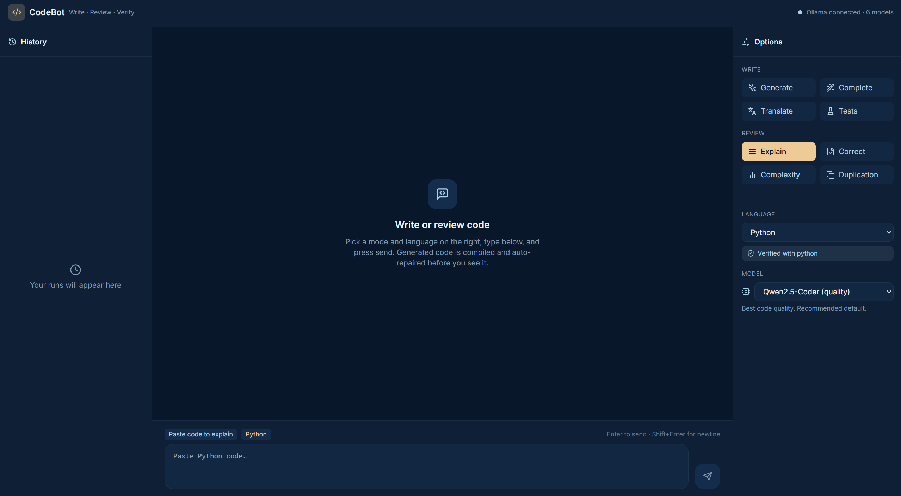
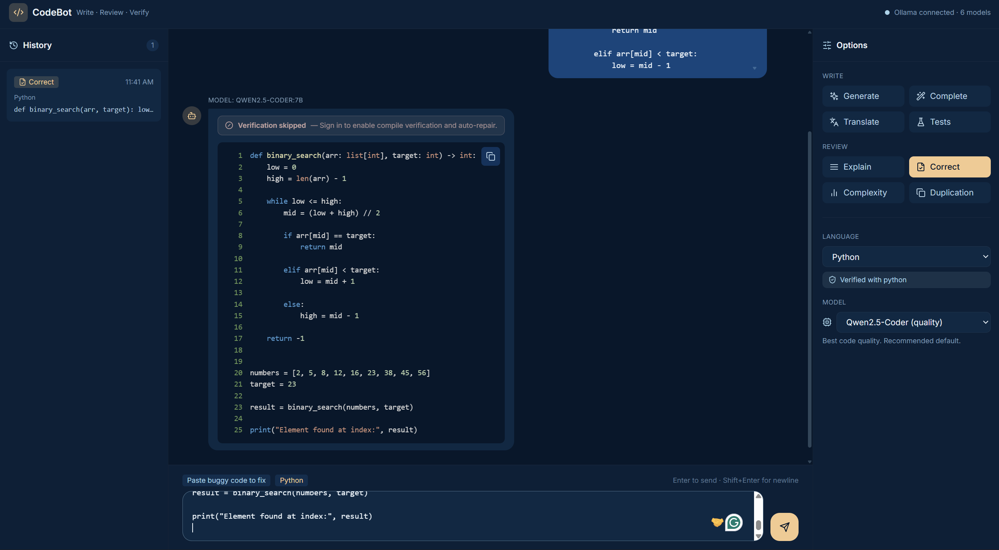
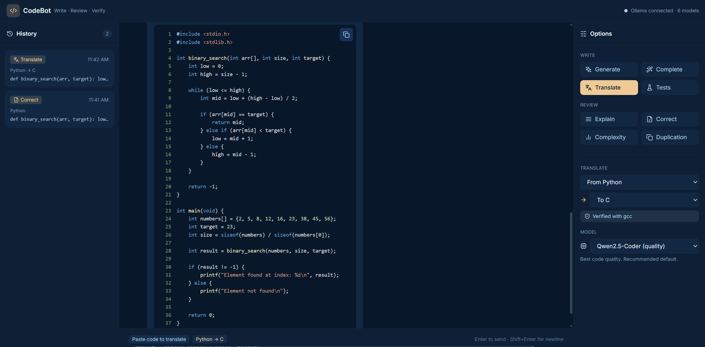
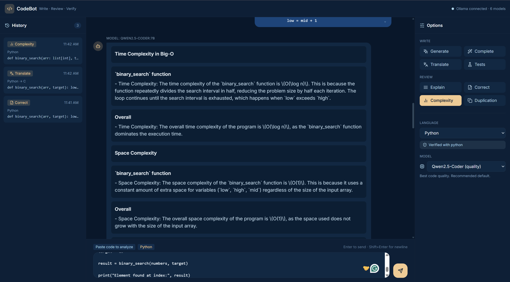

<div align="center">

#  CodeReviewBot

### AI Code Writing & Review Assistant — Python, C, and Java. Fully Local, Fully Private

[](https://reactjs.org/)
[](https://www.typescriptlang.org/)
[](https://vitejs.dev/)
[](https://tailwindcss.com/)
[](https://flask.palletsprojects.com/)
[](https://www.python.org/)
[](https://ollama.com/)
[](LICENSE)

**CodeReviewBot** writes and reviews code in **Python, C, and Java**, entirely on your machine.  
Every file it writes is handed to a real compiler; when the compiler complains, the error goes
straight back to the model and it tries again.

No API keys. No cloud. No data leaving your machine.

[Features](#-features) · [How Verification Works](#-how-verification-works) · [Installation](#-installation) · [Configuration](#-configuration) · [API Reference](#-api-reference)

</div>

---

##  Screenshots

<div align="center">

| | |
|:---:|:---:|
|  |  |
|  |  |

</div>

---

##  Overview

CodeReviewBot runs a local code model through Ollama and puts a **compiler in the loop**. A small
local model writes code that looks right and often is not, so every generated file is compiled
before you ever see it. If it fails, the real compiler output is fed back to the model as a
follow-up turn and it repairs its own work — up to two passes by default.

That loop is what turns a free 7B model into something usable, and it costs nothing but a few
seconds of latency.

---

##  Features

### Writing modes

| Mode | Description |
|---|---|
| **Generate** | Describe what you want in plain English, get a complete compilable file |
| **Complete** | Fill in stubs, TODOs, and unimplemented functions in partial code |
| **Translate** | Port code between Python, C, and Java using idiomatic target-language constructs |
| **Tests** | Write unit tests covering the normal path, edge cases, and error handling |

### Review modes

| Mode | Description |
|---|---|
| **Explain** | Plain-English breakdown of what the code does |
| **Correct** | Fix bugs and compile errors, preserving the original intent |
| **Complexity** | Big-O time and space analysis, cyclomatic complexity, nesting depth |
| **Duplication** | Find repeated logic and the refactor that removes it |

### Throughout

| | |
|---|---|
| **3 languages** | Python, C, and Java, each with its own compiler, style rules, and file conventions |
| **Compiler-verified output** | Generated code is compile-checked and auto-repaired before display |
| **Token streaming** | Watch the model write, and stop it mid-generation |
| **Model switching** | Swap between a quality local model, a fast local model, and opt-in cloud |
| **Review history** | Click any past run to restore its code, mode, language, and result |
| **100% local by default** | Inference and compilation both happen on your machine |

---

##  How Verification Works

```
        Your prompt or code
                 │
                 ▼
    ┌────────────────────────┐
    │  Language-aware prompt │   built from the LanguageSpec table
    └────────────┬───────────┘
                 ▼
    ┌────────────────────────┐
    │  Ollama  /api/chat     │   tokens stream to the browser as they arrive
    └────────────┬───────────┘
                 ▼
    ┌────────────────────────┐
    │  Extract the code file │
    └────────────┬───────────┘
                 ▼
    ┌────────────────────────┐
    │       COMPILE          │   python -m py_compile  +  pyflakes
    │  (never execute)       │   gcc -fsyntax-only -std=c11 -Wall -Wextra
    └────────────┬───────────┘   javac -Xlint:all
                 │
        ┌────────┴────────┐
     passes            fails
        │                 │
        ▼                 ▼
     Show it     Feed the compiler error back
                 as a follow-up turn, regenerate
                 (up to CRB_MAX_REPAIR_ATTEMPTS)
```

**Generated code is compiled, never executed.** `gcc` runs with `-fsyntax-only`, `javac` writes
class files into a temp directory that is deleted immediately, and nothing is ever run.

The verifier is a syntax and type gate, not a correctness prover — code that compiles can still
be logically wrong. It catches the large majority of what a small local model gets wrong, which
is the point.

If a compiler is missing (no JDK installed, say), the UI says so and the output is simply marked
**Not verified** rather than failing.

---

##  Project Structure

```
Code_Review_Bot/
├── api/                        # Flask backend
│   ├── app.py                  # Routes: /api/review, /api/generate, /api/health,
│   │                           #         /api/models, /api/languages
│   ├── config.py               # All settings + env-var overrides, model registry
│   ├── languages.py            # Per-language table: compilers, file naming, style rules
│   ├── prompts.py              # Language-aware prompt building + code extraction
│   ├── llm.py                  # Ollama /api/chat client (blocking + streaming)
│   ├── pipeline.py             # The generate → verify → repair loop
│   ├── verifier.py             # Compile-checks generated code in a temp dir
│   ├── review_bot.py           # Back-compat shim for the original review_code()
│   ├── rule_based_agent.py     # Standalone reflex-agent assignment (not wired to the API)
│   └── requirements.txt
│
├── src/                        # React + Vite + TypeScript frontend
│   ├── components/
│   │   ├── CodeEditor.tsx      # Spec + code input, submit/stop
│   │   ├── ReviewOptions.tsx   # Write and Review mode buttons
│   │   ├── Toolbar.tsx         # Language, translate target, model, verifier status
│   │   ├── ReviewResult.tsx    # Streaming output, verification badge, highlighting
│   │   ├── HistorySidebar.tsx  # Clickable history
│   │   ├── Header.tsx          # Backend/Ollama status
│   │   └── MainLayout.tsx
│   ├── contexts/ReviewContext.tsx   # State + NDJSON stream consumption
│   ├── types/index.ts
│   └── main.tsx
│
├── .env.example                # Every setting, documented
├── .gitignore
├── LICENSE
└── README.md
```

---

## ⚙️ Installation

### Prerequisites

| Requirement | Needed for |
|---|---|
| [Node.js 18+](https://nodejs.org/) | Frontend |
| [Python 3.11+](https://www.python.org/downloads/) | Backend **and** the Python verifier |
| [Ollama](https://ollama.com/download) | Local model inference |
| `gcc` ([MinGW-w64](https://www.mingw-w64.org/) / MSYS2) | The C verifier — optional |
| A JDK 17+ (`javac`) ([Temurin](https://adoptium.net/)) | The Java verifier — optional |
| NVIDIA GPU | Optional, but much faster |

The two compilers are optional. Without them the app still writes C and Java, it just cannot
compile-check the result and will label it **Not verified**.

---

### Step 1 — Install Ollama and pull the model

```bash
ollama --version
ollama pull qwen2.5-coder:7b
```

`qwen2.5-coder:7b` (~4.7 GB) is the default: it is the strongest free local code model in its
size class and is substantially better at C and Java than a general chat model. On a 12 GB GPU,
`qwen2.5-coder:14b` (~9 GB) is better still — set `CRB_MODEL` to switch.

Optionally keep a fast fallback:

```bash
ollama pull llama3.2:3b
```

---

### Step 2 — Run the backend

```bash
cd api

python -m venv ../venv
..\venv\Scripts\activate        # Windows
# source ../venv/bin/activate   # macOS / Linux

pip install -r requirements.txt
python app.py
```

Backend runs at `http://localhost:5000`. Check it with:

```bash
curl http://localhost:5000/api/health
```

That reports which models are pulled, which compilers were found, and whether cloud is enabled.

---

### Step 3 — Run the frontend

In a new terminal:

```bash
npm install
npm run dev
```

The app is live at `http://localhost:5173`.

---

##  Configuration

###  Do I need an API key?

**No.** The default setup needs no API key of any kind. Ollama runs locally on port 11434 with no
authentication, so there is nothing to sign up for and nothing to pay.

The **only** case that needs a key is if you opt in to Ollama Cloud models, which send your source
code to Ollama's servers and therefore break the "fully local, fully private" guarantee. It is off
by default.

<details>
<summary><strong>If you do want cloud models (optional)</strong></summary>

1. Get a key at [ollama.com/settings/keys](https://ollama.com/settings/keys).
2. Copy `.env.example` to `.env` in the repo root.
3. Set both of these — either alone does nothing:

```bash
CRB_ALLOW_CLOUD=true
OLLAMA_API_KEY=your_key_here
```

4. Restart the backend and pick the cloud model from the toolbar dropdown.

The backend refuses cloud models unless `CRB_ALLOW_CLOUD=true`, and the UI shows a
**"Code leaves this machine"** warning whenever a cloud model is selected.

</details>

### Settings

Copy `.env.example` to `.env` and edit. Everything is optional.

| Variable | Default | Purpose |
|---|---|---|
| `OLLAMA_HOST` | `http://127.0.0.1:11434` | Where Ollama is listening |
| `OLLAMA_API_KEY` | *(empty)* | **Only** needed for cloud models |
| `CRB_MODEL` | `qwen2.5-coder:7b` | The main local model |
| `CRB_FAST_MODEL` | `llama3.2:3b` | Fast fallback |
| `CRB_ALLOW_CLOUD` | `false` | Must be `true` to allow cloud models |
| `CRB_CLOUD_MODEL` | `gpt-oss:120b-cloud` | Which cloud model to offer |
| `CRB_VERIFY` | `true` | Turn the compile-check off entirely |
| `CRB_MAX_REPAIR_ATTEMPTS` | `2` | How many repair passes to allow |
| `CRB_COMPILE_TIMEOUT` | `20` | Seconds before a compile is abandoned |
| `CRB_TIMEOUT` | `300` | Seconds before a model request is abandoned |
| `CRB_PORT` | `5000` | Backend port |
| `VITE_API_URL` | `http://localhost:5000` | Where the frontend looks for the backend |

---

##  Deploy online

The default app is single-user and local. Hosting it turns it into a multi-user
web app with accounts. Three things change; see `.env.production.example` for the
exact variables.

### 1. Inference moves off your GPU

Cheap/free hosts have no GPU, so a local 7B model can't run there. Point the
backend at a hosted API instead — no code change, just env:

- **Ollama Cloud** (least change): `OLLAMA_HOST=https://ollama.com`,
  `OLLAMA_API_KEY=…`, and set `CRB_MODEL` to a `*-cloud` model.
- **Groq / OpenRouter** (OpenAI-compatible): `CRB_PROVIDER=openai`,
  `OPENAI_BASE_URL`, `OPENAI_API_KEY`, and `CRB_MODEL` to a model the provider serves.

### 2. Accounts via Supabase (login, signup, password reset)

1. Create a free project at [supabase.com](https://supabase.com).
2. **Authentication → Providers → Email**: enable it. Turn on "Confirm email"
   for verified signups.
3. **Authentication → URL Configuration**: set the Site URL to your deployed
   frontend (e.g. `https://your-app.vercel.app`) so confirmation and
   password-reset links point back to the app.
4. Copy three values:
   - Project URL → `VITE_SUPABASE_URL` (frontend)
   - `anon` public key → `VITE_SUPABASE_ANON_KEY` (frontend; safe to expose)
   - **JWT Secret** (Settings → API) → `SUPABASE_JWT_SECRET` (**backend only** — never ship to the browser)

The **forgot-password → emailed reset link** flow is built in: Supabase sends
the email, the link returns to the app, and the "choose a new password" form
appears automatically. No email server to run.

Set `CRB_REQUIRE_AUTH=true` (backend) and `VITE_REQUIRE_AUTH=true` (frontend) to
turn on the login wall. The backend independently verifies every token, so the
API is protected even though the login page also gates the UI.

### 3. The verifier is gated to signed-in users

Compiling user-submitted code is safe locally but a real surface on a public
server, so verification runs **only for authenticated requests**. The whole
backend runs inside the Docker container ([api/Dockerfile](api/Dockerfile), which
bundles `gcc` and a JDK), the compiler subprocess runs with CPU/memory limits,
and it runs as a non-root user. For stronger isolation put a sandbox
(nsjail/gVisor) in front of the verifier.

### Suggested free stack

| Piece | Host | Notes |
|---|---|---|
| Frontend | Vercel / Netlify | Build `npm run build`, set the `VITE_*` env vars |
| Backend | Render / Railway / Fly | Deploy `api/Dockerfile`; set backend env vars |
| Auth + DB | Supabase | Free tier; handles accounts and reset emails |
| Inference | Ollama Cloud or Groq | Free tier; set the provider env vars |

**Lock CORS:** set `CRB_CORS_ORIGINS` to your exact frontend origin — never `*`
in production.

---

##  API Reference

| Method | Endpoint | Description |
|---|---|---|
| `POST` | `/api/generate` | Streaming: newline-delimited JSON progress events |
| `POST` | `/api/review` | Blocking: one JSON response when finished |
| `GET` | `/api/health` | Ollama reachability, installed models, compiler availability |
| `GET` | `/api/models` | Configured models and whether each is usable |
| `GET` | `/api/languages` | Supported languages and their verifier status |

**Request body** (identical for both POST endpoints):

```json
{
  "mode": "generate",
  "language": "c",
  "sourceLanguage": "python",
  "code": "",
  "spec": "A function that reverses a string in place, plus a main that demonstrates it.",
  "model": "quality"
}
```

`mode` is one of `generate`, `complete`, `translate`, `tests`, `explain`, `correct`,
`complexity`, `duplication`. `language` is `python`, `c`, or `java` — for `translate` it is the
**target** and `sourceLanguage` is the origin. `spec` is required for `generate`; `code` is
required for everything else.

**Streamed events** from `/api/generate`, one JSON object per line:

```jsonc
{"type": "status",  "stage": "generating"}
{"type": "token",   "text": "#include <stdio.h>"}
{"type": "verify",  "attempt": 1, "ok": false, "status": "failed", "tool": "gcc", "output": "..."}
{"type": "repair",  "attempt": 2, "reason": "C code failed to compile."}
{"type": "done",    "result": "```c\n...\n```", "code": "...", "attempts": 2,
                    "verification": {"ok": true, "status": "passed", "detail": "..."}}
```

**Blocking response** from `/api/review`:

```json
{
  "result": "```c\n#include <stdio.h>\n...\n```",
  "code": "#include <stdio.h>\n...",
  "language": "c",
  "mode": "generate",
  "model": "qwen2.5-coder:7b",
  "attempts": 2,
  "verification": {
    "ok": true,
    "status": "passed",
    "tool": "gcc",
    "output": "",
    "detail": "C code compiles cleanly."
  }
}
```

---

##  Roadmap

- [x] **Streaming responses** — tokens stream to the UI as the model writes
- [x] **Multi-language support** — Python, C, and Java
- [x] **Code generation** — generate, complete, translate, and test modes
- [x] **Compiler verification** — generated code is compiled and auto-repaired
- [x] **Model selector** — switch between local and cloud models
- [ ] **Run generated tests** — execute in a sandbox, not just compile
- [ ] **Multi-file projects** — review and generate across a whole folder
- [ ] **Language auto-detection** — infer the language from pasted code
- [ ] **Persistent history** — save runs to local SQLite
- [ ] **Export reports** — download as PDF or Markdown
- [ ] **GitHub integration** — review PRs from a repo URL
- [ ] **VS Code extension** — trigger from inside the editor
- [ ] **Docker support** — `docker-compose up`

---

##  Tech Stack Summary

| Layer | Technology |
|---|---|
| Frontend | React 18, Vite 5, TypeScript 5, TailwindCSS 3 |
| Backend | Flask 3, Python 3.11 |
| LLM Runtime | Ollama (`/api/chat`) |
| Default Model | Qwen2.5-Coder 7B |
| Verifiers | CPython + pyflakes, gcc, javac |
| Streaming | Newline-delimited JSON over `fetch` |
| Communication | REST API (JSON) |

---

##  License

This project is licensed under the **MIT License** — see the [LICENSE](LICENSE) file for details.

```
MIT License

Copyright (c) 2025 CodeReviewBot Contributors

Permission is hereby granted, free of charge, to any person obtaining a copy
of this software and associated documentation files (the "Software"), to deal
in the Software without restriction, including without limitation the rights
to use, copy, modify, merge, publish, distribute, sublicense, and/or sell
copies of the Software, and to permit persons to whom the Software is
furnished to do so, subject to the following conditions:

The above copyright notice and this permission notice shall be included in all
copies or substantial portions of the Software.
```

---

<div align="center">

Built with Qwen2.5-Coder, Flask, and React — with a compiler keeping it honest.  
**Star ⭐ this repo if you found it useful!**

</div>
